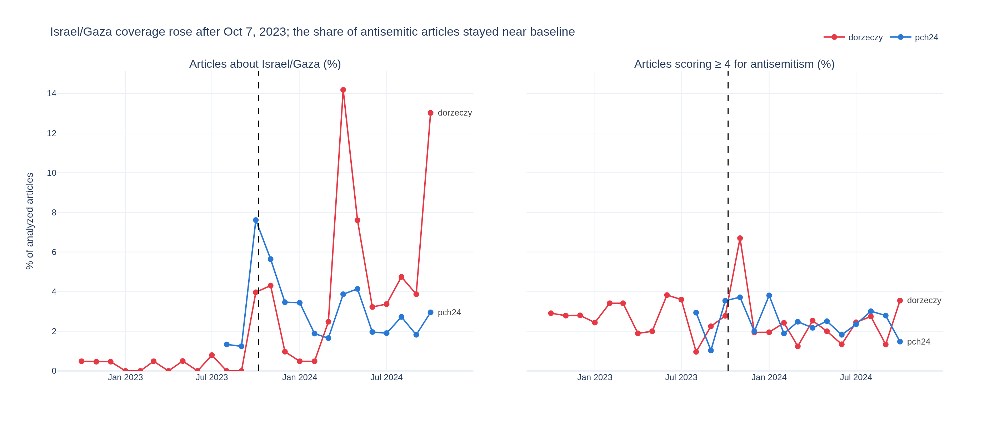
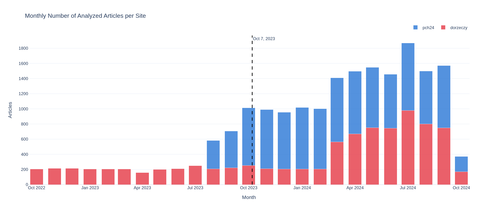
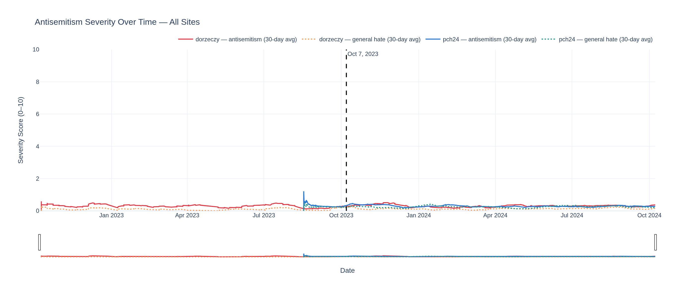
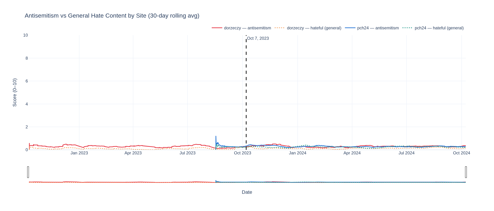
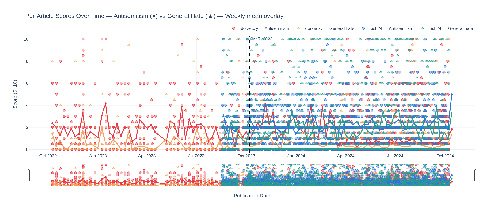
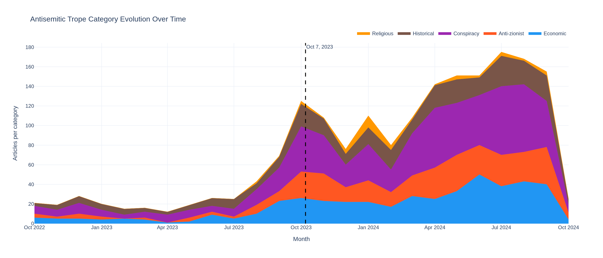

# otwarta-pre-post-7oct

**Did antisemitic content in Polish right-wing media increase after the Hamas attack on
Israel on October 7, 2023?**

This repository contains the full pipeline (scraping → LLM scoring → statistics → charts)
and the results for two outlets, **dorzeczy.pl** and **pch24.pl**, over two years
(Oct 7, 2022 → Oct 7, 2024).

## TL;DR

- **Coverage of Israel/Gaza rose sharply after Oct 7** (dorzeczy: 0.3 % → 5.2 % of articles;
  pch24: 1.4 % → 3.3 %).
- **Antisemitic content did not rise in any lasting way.** Mean severity (0–10) was 0.304
  before vs 0.298 after (Mann-Whitney p = 0.21, Cohen's d = −0.01). The share of articles
  scoring ≥ 4 went from 2.6 % to 2.5 %.
- dorzeczy.pl shows a **short spike in November 2023** (6.7 % of articles scored ≥ 4, vs a
  pre-period monthly range of 1.0–3.8 %) that returned to baseline by December.
- The results come with real caveats (uneven coverage, scoring by a local LLM, no human
  validation). See [Limitations](#limitations).



---

## Corpus

| Site | Articles | Date range | Before Oct 7 | After Oct 7 | Sent to the LLM (passed keyword filter) |
|---|---:|---|---:|---:|---:|
| dorzeczy.pl | 9,000 | 2022-10-07 → 2024-10-07 | 2,543 | 6,457 | 3,066 (34 %) |
| pch24.pl | 10,558 | 2023-08-16 → 2024-10-07 | 1,028 | 9,530 | 1,387 (13 %) |
| **Total** | **19,558** | | **3,571** | **15,987** | **4,453 (23 %)** |

- **dorzeczy.pl** articles come from the weekly magazine archive (`tygodnik.dorzeczy.pl`),
  one page per issue.
- **pch24.pl** articles come from the site's XML sitemaps. Sitemap coverage only reaches
  back to mid-August 2023, so pch24 has **about 7 weeks of pre-Oct-7 data**.



## Method

1. **Scraping.** Async `httpx` scrapers per site. They respect robots.txt and crawl delays
   (2 s for dorzeczy.pl) and parse dates with a cascade: `<time>` tag → Polish month regex →
   meta tags → JSON-LD.
2. **Keyword pre-filter.** Articles that contain none of about 80 Polish keywords
   (Jewish/Israel terms, coded antisemitic vocabulary, minority groups) get score 0 without
   calling the model. This covered 77 % of the corpus.
3. **LLM scoring.** Each remaining article is scored by **llama3.1 (8B)**, run locally via
   [Ollama](https://ollama.com/), against a 0–10 rubric
   ([`antisemitism_system.txt`](src/otwarta/analysis/prompts/antisemitism_system.txt)).
   The rubric runs from 0 (neutral mention) through 2 (coded dog-whistles such as
   "globalists" or "Judeopolonia"), 3–4 (tropes with plausible deniability), 5–6 (explicit
   conspiracy framing) and 7–8 (group accusations, dehumanization) up to 9–10 (slurs, calls
   for violence). If llama3.1 scores an article below 2, **mistral-nemo** re-scores it and
   the higher score is kept. The model also returns a general hate score (other minorities),
   trope categories, and an `is_about_israel_gaza` flag.
4. **Statistics.** Pre/post comparison with a two-sided Mann-Whitney U test, Cohen's d, and
   95 % bootstrap CIs on each period's mean
   ([`stats.py`](src/otwarta/visualization/stats.py)).

## Results

Full table: [`data/processed/prepost_tests.csv`](data/processed/prepost_tests.csv) ·
monthly series: [`data/processed/monthly_stats.csv`](data/processed/monthly_stats.csv) ·
interactive report: [`data/processed/report.html`](data/processed/report.html)
(download and open locally).

### All articles, pre vs post Oct 7

| Site | Mean pre [95 % CI] | Mean post [95 % CI] | ≥ 4 pre | ≥ 4 post | ≥ 7 pre | ≥ 7 post | p (MWU) | Cohen's d |
|---|---|---|---:|---:|---:|---:|---:|---:|
| dorzeczy | 0.303 [0.260, 0.345] | 0.315 [0.291, 0.340] | 2.7 % | 2.2 % | 0.5 % | 0.5 % | 4.5e-5 | 0.01 |
| pch24 | 0.308 [0.244, 0.376] | 0.287 [0.267, 0.308] | 2.4 % | 2.6 % | 0.8 % | 0.6 % | 0.41 | −0.02 |
| **both** | 0.304 [0.270, 0.341] | 0.298 [0.283, 0.315] | 2.6 % | 2.5 % | 0.6 % | 0.5 % | 0.21 | −0.01 |

The dorzeczy p-value is small, but the effect is negligible (d = 0.01). It comes from
more articles receiving *low non-zero* scores (more Israel coverage passing the keyword
filter), not from more severe content: the ≥ 4 and ≥ 7 shares did not go up.

### Robustness checks

| Subset | Site | Mean pre | Mean post | p (MWU) | Cohen's d | Reading |
|---|---|---:|---:|---:|---:|---|
| ±60 days around Oct 7 | both | 0.286 | 0.350 | 0.10 | 0.06 | small, non-significant bump right after the attack |
| ±60 days around Oct 7 | dorzeczy | 0.232 | 0.385 | 0.22 | 0.14 | the Oct–Nov 2023 spike |
| LLM-scored articles only | dorzeczy | 1.78 | 0.77 | 3e-40 | −0.55 | **selection effect**: many more neutral Israel articles pass the filter after Oct 7 |
| LLM-scored articles only | pch24 | 2.18 | 2.20 | 0.69 | 0.01 | no change |

The ±60-day window compares both sites over the same short period. This removes most of
the coverage imbalance and still shows no significant increase.

### Charts

**Rolling 30-day mean severity, both sites.** The line stays flat, well below 1 on the
0–10 scale, throughout.


**Antisemitism vs general hate score by site.** The general hate score (other minorities)
stays low and flat, like the antisemitism score, with no shift after Oct 7.


**Per-article scores with weekly mean overlay.** High-scoring articles (≥ 7) occur in
both periods at a similar rate.


**Trope categories over time (absolute counts).** These counts track the *volume of
LLM-scored articles*, which grew with Israel coverage and with dorzeczy's larger 2024
sample. Read them as the mix of tropes, not their prevalence. Anti-Zionist framing becomes a
larger part of the mix after Oct 7.


More charts (per-site time series, monthly box plots, score distribution) are in
[`data/processed/charts/`](data/processed/charts/).

## Conclusion

In this sample there is **no evidence of a sustained increase in antisemitic content** in
dorzeczy.pl or pch24.pl in the year after October 7, 2023. Both outlets covered Israel and
Gaza much more, but the share of articles the model rated antisemitic (≥ 4) stayed at about
2–3 % before and after. The one exception is a short spike in dorzeczy.pl in November 2023.

## Limitations

- **Uneven coverage.** pch24 has only about 7 weeks of pre-Oct-7 data. dorzeczy's sample
  is about 200 articles/month until February 2024 and 560–980/month afterwards. Neither is
  a full census of the site.
- **LLM scoring, not human coding.** Scores come from an 8B local model and have not been
  validated against human annotators. Individual scores can vary by ±1 point, and the model
  may miss subtle or context-dependent antisemitism, or over-flag neutral reporting.
- **The keyword pre-filter** sets 77 % of articles to 0 unseen. Antisemitic content that
  uses none of the keywords would be missed.
- **Paywalls.** Some dorzeczy.pl article bodies are truncated, which may lower their scores.
- **Scores are probabilistic assessments of text, not judgments about authors or outlets.**

## Reproduce

Requirements: Python ≥ 3.12, [uv](https://docs.astral.sh/uv/), and
[Ollama](https://ollama.com/) with `llama3.1` and `mistral-nemo` pulled. No paid APIs.

```bash
uv sync && uv run playwright install chromium
uv run otwarta db init

# Scrape (separate terminals)
uv run otwarta scrape site dorzeczy --start 2022-10-07 --end 2024-10-07
uv run otwarta scrape site pch24    --start 2022-10-07 --end 2024-10-07

# Score with the local LLM (resumable)
uv run otwarta analyze run --workers 4

# Outputs
uv run otwarta visualize all             # data/processed/report.html
uv run python scripts/export_charts.py   # data/processed/charts/*.png
uv run python scripts/export_stats.py    # data/processed/*.csv

# Or run the whole thing from a browser dashboard
uv run otwarta dashboard
```

The scraped article database is **not included** (the articles are copyrighted). The
committed outputs contain only aggregates, plus article titles in the interactive
report's hover tooltips.

See [INSTRUCTIONS.md](INSTRUCTIONS.md) for settings, adding sites, and defining new analyses.
The analysis step is driven by YAML (`config/analysis/`), so the same pipeline can score
other phenomena, e.g. anti-Ukrainian sentiment, with a different rubric.

## Project layout

```
src/otwarta/
  scrapers/        async base scraper + site adapters (dorzeczy, pch24)
  analysis/        Ollama client, YAML-driven detector, scoring prompt
  storage/         SQLAlchemy models, SQLite (WAL) repository
  visualization/   Plotly charts, statistics, HTML report
  dashboard/       FastAPI + SSE browser dashboard
  cli/             `otwarta` Typer CLI
config/            site and analysis YAML configs
scripts/           chart and statistics exporters
data/processed/    published outputs (charts, CSVs, report)
tests/             pytest suite
```

Development: `uv run --extra dev ruff check src tests scripts`,
`uv run --extra dev mypy src`, `uv run pytest`.

## Ethics

This is academic research. Scraping respects robots.txt and crawl delays. Antisemitic
content is measured, not reproduced: no article text is published in this repository.

## License

[MIT](LICENSE)
